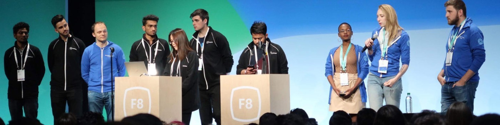
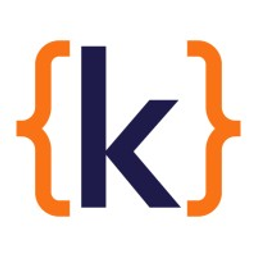
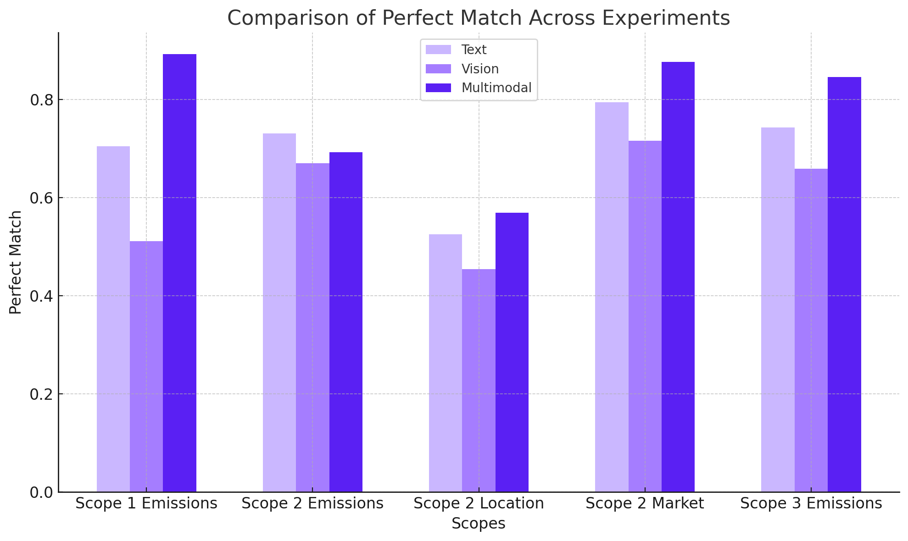
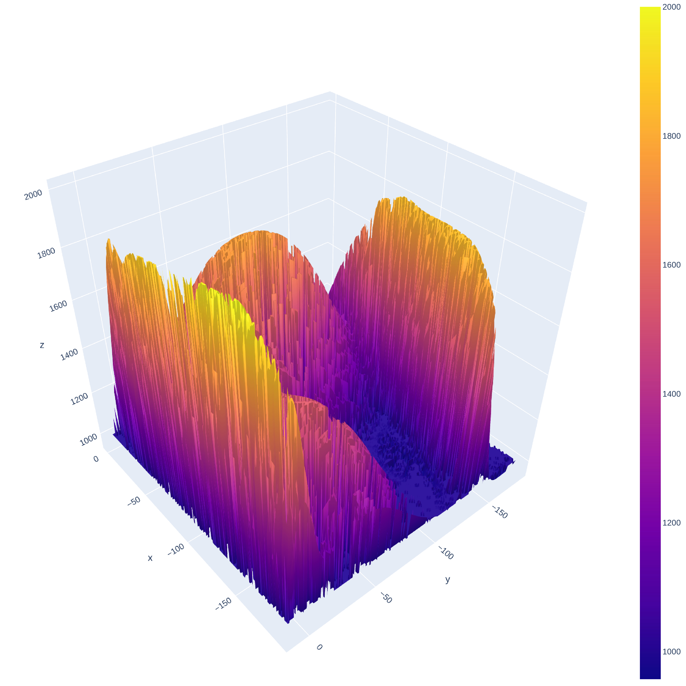
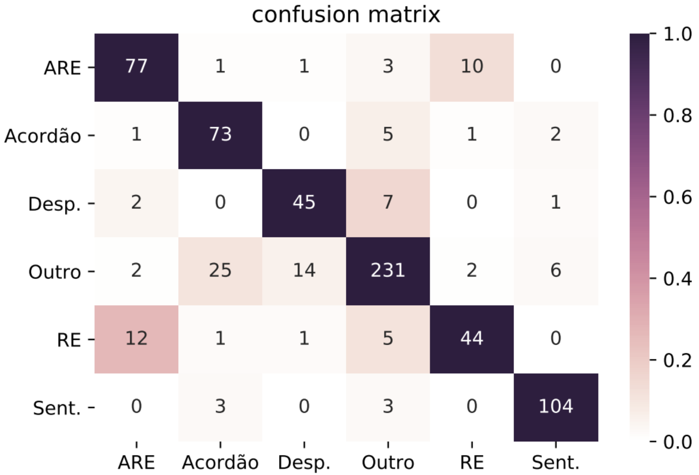

<section class="home-hero">
  
Senior AI Engineer · Florianópolis, Brazil

  <h1>Building reliable AI products from research to production.</h1>
  
I turn complex data and machine-learning problems into useful software, backed by seven years of industry experience and a double master's degree in Data Science and AI.

</section>

<ul class="credibility-strip" aria-label="Profile highlights">
  <li><strong>7+ years</strong>AI &amp; software</li>
  <li><strong>Double MSc in Data Science &amp; AI</strong>Aalto University &amp; TU Eindhoven</li>
  <li><strong>Global experience</strong>Brazil, US, Europe &amp; remote teams</li>
</ul>

<section class="award-section" aria-labelledby="award-title">
  

    <h2 id="award-title">Award</h2>
    

      <a href="https://www.facebook.com/watch/?v=432443067305810">Watch pitch →</a>
      <a href="https://devpost.com/software/opencurriculum-by-wattba">View project →</a>
    

  

  

    
    

      <h3>Facebook F8 Hackathon Finalist</h3>
      
Top 8 out of 55 teams in San Jose, including a project pitch to Mark Zuckerberg.

    

  

</section>

<section class="experience-strip" aria-labelledby="experience-title">
  

    <h2 id="experience-title">Experience</h2>
    <a href="/cv/#experiences">View full experience →</a>
  

  

    <a href="https://www.kadoa.com/">Kadoa</a>
    <a href="https://www.trebu.ai/">Trebu</a>
    <a href="https://www.datia.app/">Datia</a>
    <a href="https://www.turing.com/">Turing</a>
    <a href="https://www.itau.com.br/">Itaú</a>
  

</section>

<section class="featured-section">
  

    <h2 class="home-section-title">Featured Work</h2>
    

      <a href="/portfolio/">View all projects →</a>
      <a href="/publications/">View all publications →</a>
    

  

  <a class="featured-work__card" href="/publication/pdf_information_extraction_llms">
    
    

      Master's thesis · Document AI
      <h3>LLMs for Financial Report Extraction</h3>
    

  </a>

  <a class="featured-work__card" href="https://bdm.unb.br/bitstream/10483/29340/1/2021_GabrielGomesZiegler_tcc.pdf">
    
    

      Bachelor's thesis · MRI
      <h3>CoDePPI</h3>
    

  </a>

  <a class="featured-work__card" href="/publication/2018_ML4D_NIPS_document_classification">
    
    

      NeurIPS workshop · NLP
      <h3>Bi-LSTM Document Classification for Brazil's Supreme Court</h3>
    

  </a>

</section>

