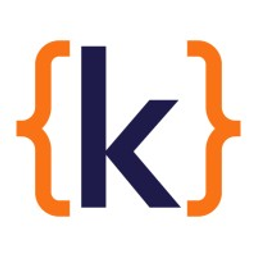




  


<section class="cv-summary">
  

    
Curriculum Vitae

    <h1>Senior AI Engineer</h1>
    
8+ years in AI &amp; software · Double MSc in Data Science &amp; AI from Aalto University and TU Eindhoven.

  

</section>

## Experiences

Feb 2026
Present

<h3 class="cv-entry-title">
  Senior AI Engineer
  <a class="cv-entry-org" href="https://www.kadoa.com/"> Kadoa</a>
</h3>

<i class="fas fa-map-marker-alt" aria-hidden="true"></i> Zurich, Switzerland (Remote)

Building AI-native infrastructure for real-time web data extraction at Kadoa.

<ul>
<li>Lead development across autonomous agents, workflow automation, public APIs, MCP integrations, and monitoring systems.</li>
<li>Built the <code>@kadoa/cli</code> and MCP server from scratch, including OAuth authentication, HTTP transport, and deployment to GKE.</li>
<li>Ship end-to-end product and platform work spanning UX, backend reliability, compliance, and production operations.</li>
</ul>

<strong>TypeScript</strong> <strong>Node.js</strong> <strong>React.js</strong> <strong>Next.js</strong> <strong>Express.js</strong> <strong>MCP</strong> <strong>GCP</strong> <strong>GKE</strong> <strong>Kubernetes</strong> <strong>Docker</strong> <strong>PostgreSQL</strong> <strong>Redis</strong> <strong>Linux</strong> <strong>GNU Make</strong> <strong>OAuth</strong> <strong>GitHub Actions</strong>

Jun 2025
Nov 2025

<h3 class="cv-entry-title">
  Senior AI Software Engineer
  <a class="cv-entry-org" href="https://www.trebu.ai/"> Trebu</a>
</h3>

<i class="fas fa-map-marker-alt" aria-hidden="true"></i> Monterrey, MX (Remote)

Building agentic systems to automate the logistics industry in Mexico. I wore many hats, from backend, frontend, and infra, to building agents.

<strong>AWS</strong> <strong>Python</strong> <strong>Django</strong> <strong>React</strong> <strong>Docker</strong> <strong>LangGraph</strong> <strong>LangChain</strong> <strong>Redis</strong> <strong>PostgreSQL</strong>

Jan 2025
Present

<h3 class="cv-entry-title">
  Consulting AI Engineer
  <a class="cv-entry-org" href="https://www.linkedin.com/company/106311322/admin/dashboard/"> Ziegler Software & AI Solutions</a>
</h3>

<i class="fas fa-map-marker-alt" aria-hidden="true"></i> Remote

Building software and AI solution for clients.

<strong>Python</strong> <strong>AWS</strong> <strong>FastAPI</strong> <strong>LLMs</strong> <strong>RAG</strong> <strong>Faiss</strong> <strong>Vector DB</strong> <strong>Testing</strong> <strong>OCR</strong> <strong>PDF parsing</strong> <strong>Unit tests</strong> <strong>CI</strong> <strong>CD</strong>

Feb 2024
Nov 2024

<h3 class="cv-entry-title">
  Senior Software Engineer
  <a class="cv-entry-org" href="https://www.datia.app/"> Datia</a>
</h3>

<i class="fas fa-map-marker-alt" aria-hidden="true"></i> Stockholm, Sweden (Remote)

At Datia, I contributed across multiple domains, such as data, backend, and frontend development to enhance the product experience. Key achievements include:

<ul>
<li>Developing an LLM-powered system capable of extracting key performance indicators (KPIs) from documents with high accuracy, streamlining data extraction processes.</li>
<li>Designing and implementing an internal dashboard for sustainability data visualization, enabling more informed decision-making.</li>
<li>Enhancing the product's backend and frontend by fixing critical bugs and delivering impactful features using Node.js and React.</li>
</ul>

<strong>Python</strong> <strong>AWS</strong> <strong>LLMs</strong> <strong>Testing</strong> <strong>OCR</strong> <strong>PDF parsing</strong>

Aug 2022
Feb 2024

<h3 class="cv-entry-title">
  Python Engineer
  <a class="cv-entry-org" href="https://www.turing.com/"> Turing.com</a>
</h3>

<i class="fas fa-map-marker-alt" aria-hidden="true"></i> California, USA (Remote)

Python developer for one of the biggest AI research companies.

<strong>Python</strong> <strong>AWS</strong> <strong>LLMs</strong> <strong>Testing</strong> <strong>Pytorch</strong>

Mar 2021
Aug 2022

<h3 class="cv-entry-title">
  Machine Learning Engineer
  <a class="cv-entry-org" href="https://en.wikipedia.org/wiki/Ita%C3%BA_Unibanco"> Itaú Unibanco</a>
</h3>

<i class="fas fa-map-marker-alt" aria-hidden="true"></i> São Paulo, Brazil (Remote)

ML Engineer with experience in designing, implementing, deploying, and monitoring speech ML systems. Worked with Data Science and MLOps teams to deliver data-intensive systems.

<ul>
<li>Improved speaker verification model by ~20% and speaker diarization model by ~30% on noisy datasets</li>
<li>Deployed APIs and end-to-end batch-processing Speech Recognition System</li>
<li>Experienced in using AWS infrastructure, including SQS, SNS, S3, Sagemaker, ECS Fargate, ECR, EFS, Lambda, and API Gateway</li>
</ul>

<strong>API Gateway</strong> <strong>IAM</strong> <strong>KMS</strong> <strong>ECS</strong> <strong>EFS</strong> <strong>CodeBuild</strong> <strong>CodePipeline</strong> <strong>CloudWatch</strong> <strong>Fargate</strong> <strong>Lambda</strong> <strong>Sagemaker</strong> <strong>SQS</strong> <strong>SNS</strong> <strong>S3</strong> <strong>Python</strong> <strong>Pytorch</strong> <strong>Hugging Face Transformers</strong> <strong>Docker</strong> <strong>Flask</strong> <strong>Linux</strong>

Mar 2020
Sep 2020

<h3 class="cv-entry-title">
  Data Scientist
  <a class="cv-entry-org" href="https://www.bb.com.br/pbb/pagina-inicial/atendimento/bb-no-mundo/about-us#/"> Banco do Brasil</a>
</h3>

<i class="fas fa-map-marker-alt" aria-hidden="true"></i> Brasília (Remote)

Responsible for ETL pipelines, EDA, Insights Reports and client-focused Machine Learning Models for Classification, Regression, and Clustering.

<ul>
<li>Improved the credit limit model by 10 percentage points in F1-Score.</li>
</ul>

<strong>Python</strong> <strong>SQL</strong> <strong>H2O AutoML</strong> <strong>SAS</strong> <strong>IBM DB2</strong>

Apr 2019
Jul 2019

<h3 class="cv-entry-title">
  Data Scientist
  <a class="cv-entry-org" href="https://vert.com.br/"> Vert</a>
</h3>

<i class="fas fa-map-marker-alt" aria-hidden="true"></i> Brasília, Brazil

Responsible for creating a dashboard in SAS Viya with data from national transport traffic.

<strong>SAS Viya</strong> <strong>SQL</strong> <strong>Python</strong>

Apr 2019
Apr 2019

<h3><a href="https://www.facebook.com/watch/?ref=saved&v=432443067305810&t=2205" style="text-decoration: none;"> Facebook F8 Hackathon Finalists 2019</a></h3>

<i class="fas fa-map-marker-alt" aria-hidden="true"></i> San Jose, California

Selected as Top 8 Finalist out of 55 teams in the annual Facebook F8 Hackathon. <strong>Our team pitched to Mark Zuckerberg personally</strong> being primarily responsible for using Deep Learning models for text summarization and translation.

Mar 2018
Apr 2019

<h3 class="cv-entry-title">
  Machine Learning Researcher & Developer (NLP)
  <a class="cv-entry-org" href="https://ailab.unb.br/"> AI Lab</a>
</h3>

<i class="fas fa-map-marker-alt" aria-hidden="true"></i> Brasilia, Brazil

Responsible for EDA, ETL and development of the multiclass and multilabel (over 1000s of classes) ML model for document classification for the supreme court in the biggest AI project in the Brazilian Judiciary.

<ul>
<li>Model performance F1 score > 80%, performing way above the human performance evaluated for the same task.</li>
</ul>

<strong>Python</strong> <strong>Linux</strong> <strong>RabbitMQ</strong> <strong>PostgreSQL</strong> <strong>XGBoost</strong> <strong>SpaCy</strong> <strong>NLTK</strong> <strong>Docker</strong> <strong>Git</strong>

___

## Education

Sep 2022
Jul 2024

<h3 class="cv-entry-title">
  MSc Data Science
  <a class="cv-entry-org" href="https://www.aalto.fi/en/aalto-university"> Aalto University</a>
</h3>

<i class="fas fa-map-marker-alt" aria-hidden="true"></i> Helsinki, Finland

Scholar in the EIT Digital double master's degree in Data Science & Artificial Intelligence.

Sep 2022
Jul 2024

<h3 class="cv-entry-title">
  MSc Data Science
  <a class="cv-entry-org" href="https://www.tue.nl/en/education/?gclid=CjwKCAjwivemBhBhEiwAJxNWN-0e8eFIGUuX-g6QhU_XCij4glyJLzqvcR9ucu8I07kVRXRIURZRaRoCKJgQAvD_BwE"> Eindhoven University of Technology</a>
</h3>

<i class="fas fa-map-marker-alt" aria-hidden="true"></i> Eindhoven, Netherlands

Scholar in the EIT Digital double master's degree in Data Science & Artificial Intelligence.

Jul 2023
Aug 2023

<h3 class="cv-entry-title">
  Summer School
  <a class="cv-entry-org" href="https://www.tum.de/en/"> Technische Universitët München</a>
</h3>

<i class="fas fa-map-marker-alt" aria-hidden="true"></i> Munich, Germany

Collaborated with Siemens on creating <i>EmissionAware</i>: a new software business to ease access to carbon-emission within the supply chain for forecasting and reducing Scope 3 emissions.

Aug 2015
May 2021

<h3 class="cv-entry-title">
  Bachelor of Software Engineering (4.13/5.0)
  <a class="cv-entry-org" href="https://www.unb.br"> University of Brasília</a>
</h3>

<i class="fas fa-map-marker-alt" aria-hidden="true"></i> Brasília, Brazil

Thesis: <a href="https://gabrielziegler3.github.io/publication/codeppi">Context-Dependent Probabilistic Prior Information for MRI Reconstruction</a>

Jan 2014
Dec 2014

<h3 class="cv-entry-title">
  Exchange Student
  <a class="cv-entry-org" href="http://www.rangitoto.school.nz"> Rangitoto College</a>
</h3>

<i class="fas fa-map-marker-alt" aria-hidden="true"></i> Auckland, New Zealand

___

## Publications & Awards

<a href="https://link.springer.com/chapter/10.1007/978-3-031-30047-9_30">Dropping Incomplete Records is (not so) Straightforward</a>

IDA 2023: Advances in Intelligent Data Analysis XXI

<a href="https://arxiv.org/abs/1811.11569">Document classification using a Bi-LSTM to unclog Brazil's Supreme Court</a>

NeurIPS 2018 Workshop on Machine Learning for Developing World (ML4D)

<a href="http://icofcs.org/2018/papers-published-001.html">Document type classification for Brazil’s Supreme Court using a Convolutional Neural Network</a>

ICOFCS 2018 Selected as Best Paper

<section class="cv-languages">
<h2>Languages</h2>

<strong>Portuguese</strong>
Native

<strong>English</strong>
Fluent · C1 · TOEFL iBT 102

<strong>Spanish</strong>
Limited working proficiency

</section>
